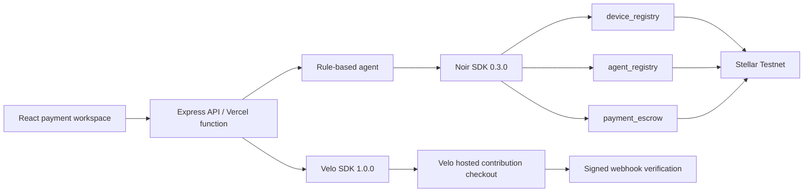
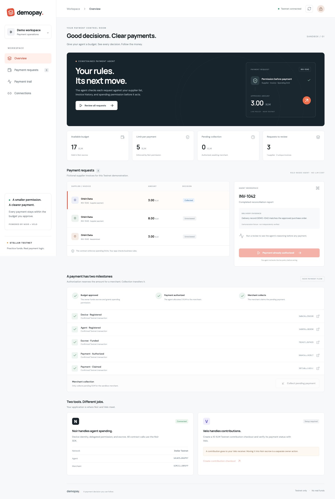
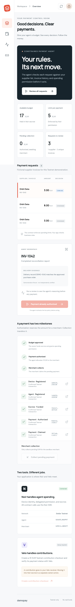

# DemoPay

One-line pitch: A constrained payment operations agent for Stellar fintech teams that reviews supplier requests, pays eligible invoices, and exposes the difference between authorization and collection.

**Live website:** Deployment pending Vercel authorization.
**Demo video (2 min):** To be recorded by the builder after deployment.
**Pitch deck:** To be supplied by the builder. A talk track is in [docs/demo-script.md](docs/demo-script.md).
**Team:** Solo builder — registered name and Discord handle to be completed before submission.

## Problem

A payment request is not the same as permission to spend, and authorization is not the same as receipt of funds. A Stellar payment application needs to check business rules, respect the payer's delegated limits, and explain where the payment stands. DemoPay explores that workflow for teams building payments on Stellar; it does not claim validated customer demand or measured cost savings.

## Solution

DemoPay is a Testnet sandbox with three fictional supplier requests: a 3 XLM eligible invoice, an 8 XLM request above the 5 XLM limit, and a repeated invoice. A transparent rule-based agent decides whether to authorize or hold each request. The Builder Handbook explicitly permits rule-based payment logic, so running this prototype needs no paid model API.

The dashboard shows policy checks, live escrow balances, recipient collection and explorer links. Its sample delivery records are fixtures, not an OCR, fraud detection or delivery-verification service. An operator token protects money-moving demo actions; public visitors can review the workspace.

## How the agentic payment works

1. Dedicated Testnet owner, agent and merchant accounts are funded with free Friendbot XLM.
2. The owner registers a software device identity through the Noir SDK, permits the agent to spend native XLM up to 5 XLM per payment, and deposits 20 XLM in escrow.
3. The agent evaluates supplier approval, matching evidence, duplicate invoice identity, available budget and current policy. The client supplies only a request ID; server-side fixtures fix the amount, recipient and nonce.
4. For eligible INV-1042, the agent calls `checkPayment`, then `authorizePayment` for **3 XLM** to the sandbox merchant. This leaves 17 XLM available and 3 XLM pending collection.
5. The merchant signs `claim` through the SDK. Collection is a separate action and collects all pending native XLM for this dedicated merchant.
6. The other requests are held. The demo's single payable invoice has immutable nonce `1`, preventing a second authorization even across server restarts or concurrent instances. This bounded sandbox is not a general-purpose invoice database.
7. Separately, an operator can create a **10 XLM Velo contribution checkout**, inspect its status through the Velo SDK and accept signed webhook notifications. Checkout funds go to the Velo receiver; they do **not** automatically fund Noir escrow, and a Velo webhook does **not** prove a Noir payout settled.

The agent chooses the payment from the request; the operator starts a run rather than directly specifying a transfer. Expired permissions, unknown state and failed reads stop the flow.

## Architecture



Secrets are server-side only. No app endpoint accepts an arbitrary signing payload, destination or transfer amount. Dedicated demo wallets never hold real funds.

## Noir integration

- SDK: **`@noirx402/agent-sdk` 0.3.0**, pinned in [packages/agent/package.json](packages/agent/package.json).
- Contracts: `device_registry`, `agent_registry`, `payment_escrow`, pinned to the exact addresses in the supplied Builder Handbook; see [packages/shared/src/index.ts](packages/shared/src/index.ts).
- Live policy reads and decision context: [packages/agent/src/index.ts](packages/agent/src/index.ts#L134). Payment preflight and authorization: [agent execution](packages/agent/src/index.ts#L189). Merchant collection: [claim](packages/agent/src/index.ts#L214).
- Owner initialization uses `execute` with `registerDevice`, `registerAgent` and `fundEscrow`: [scripts/setup-testnet.ts](scripts/setup-testnet.ts#L69).
- Exact-amount business rules: [packages/agent/src/decide.ts](packages/agent/src/decide.ts).
- No Noir contracts are redeployed, and no contract invocation is manually encoded outside the SDK. The Stellar SDK is used for key generation and the native XLM token ID.
- The software UID is generated locally and hashed. NFC hardware is not required by the handbook.
- RPC v30 removed a legacy success flag still expected by Noir 0.3.0. [The compatibility adapter](packages/agent/src/events.ts) supplies the flag for contract events to Noir's own decoder; [paymentProofs](packages/agent/src/index.ts#L55) independently checks each relevant transaction's successful receipt before treating it as evidence. No Noir contract call bypasses the SDK.

## Velo integration

- SDK: **`@carts1024/velo-sdk` 1.0.0**. npm's current `latest` is 1.0.0; the handbook's alpha-tag advice predates this release.
- `checkout.sessions.create` creates a separate Testnet budget-contribution session.
- `paymentIntents.retrieve` checks the canonical contribution status; a success-page redirect never counts as payment proof.
- `Velo.webhooks.verify` verifies the raw body and signature. Duplicate deliveries have no money-moving effect because this receiver only acknowledges verified notifications; status is read from Velo.
- Checkout SDK call: [apps/server/src/velo.ts](apps/server/src/velo.ts#L17). Signature verification: [webhooks.verify](apps/server/src/velo.ts#L29).
- Canonical status retrieval: [apps/server/src/app.ts](apps/server/src/app.ts#L143).
- Live checkout needs a valid project Testnet API key, configured receiver and Velo Pay activation. Missing credentials disable checkout rather than fabricate a payment. Live Velo qualification is recorded in [docs/verification.md](docs/verification.md).

## Testnet proof

The rule-based agent authorized **3 XLM**, and the merchant collected it:

- [Agent payment authorization](https://stellar.expert/explorer/testnet/tx/6de41e8024a31e0d11ffead82251eeeb0a0e0b4f3bf5589e40d8546ad4c428c7)
- [Merchant collection](https://stellar.expert/explorer/testnet/tx/3871abd7997d9129dd4628975667f7b46d3acbbd81e04ee8680e3236d5ccd2cc)

The recorded post-payment balance is **17 XLM**, with **0 pending**. Full public evidence: [docs/testnet-proof.json](docs/testnet-proof.json). Owner setup transactions: [docs/testnet-setup.json](docs/testnet-setup.json). No private keys are in these files.

## Repo structure

```text
apps/web/          React/Vite website
apps/server/       Express API, operator authorization, Velo integration
api/               Vercel serverless entrypoint
packages/agent/    Payment decisions and all Noir SDK calls
packages/shared/   Request fixtures, types and handbook contract IDs
scripts/           Repeatable Testnet setup, payment proof and browser checks
docs/              Screenshots, public Testnet evidence and demo notes
```

## Run it locally

1. Install Node **24.22.1 or a newer patched 24.x release**, npm and Git. No real crypto is required. The demo creates dedicated Testnet wallets; no browser wallet is required for this server-signed sandbox.
2. Run `npm install` once from the repository root.
3. Copy `.env.example` to `.env`. Keep it private. For a preview, leave keys empty. Add your Velo Testnet key for checkout.
4. Run `npm run setup:testnet -- --execute` to create demo accounts, request free Testnet funding and initialize the Noir budget. It saves secrets to `.env` without printing them and can resume incomplete setup.
5. Run `npm run dev`, then open `http://localhost:5173`.
6. Read `ADMIN_TOKEN` privately from `.env`. Use the lock button in the top-right of the website to enter it. The browser keeps it in tab-scoped session storage.
7. Review all requests, run the agent on INV-1042, then collect as the merchant. These actions consume only Testnet tokens. Repeated runs of the payable invoice must not create another payment.
8. Run `npm run typecheck`, `npm test`, and `npm run build`.

For CLI-only payment evidence, run `node --env-file=.env --import tsx scripts/prove-payment.ts --execute`. This uses the same agent module as the website, pays the one eligible invoice and collects it. Do not run it before a live demo unless you want that sandbox invoice already paid.

## Environment variables

| Name                | What it is                                     | Where to get it              |
| ------------------- | ---------------------------------------------- | ---------------------------- |
| OWNER_SECRET        | Dedicated Testnet budget owner's signing key   | Generated privately by setup |
| AGENT_SECRET        | Dedicated constrained Testnet agent key        | Generated privately by setup |
| MERCHANT_SECRET     | Dedicated Testnet recipient key                | Generated privately by setup |
| DEVICE_HASH         | SHA-256 software device identity               | Generated by setup           |
| SETUP_LEDGER        | First ledger for this sandbox's event evidence | Saved by setup               |
| ADMIN_TOKEN         | Operator access token                          | Generated privately by setup |
| VELO_API_KEY        | Project Testnet API key for checkout/status    | Velo → Build → API Keys      |
| VELO_WEBHOOK_SECRET | Signing secret for the configured endpoint     | Velo webhook settings        |
| APP_URL             | Public website origin or local frontend origin | Your Vercel deployment URL   |
| PORT                | Local API port; default 3001                   | Optional local setting       |

Set runtime secrets privately in Vercel, never in the frontend or README. The webhook URL is `https://YOUR_DEPLOYMENT/api/webhooks/velo`.

## Screenshots





## What's next

- Replace fictional supplier evidence with a real source and verify request ownership.
- Add a durable invoice store, per-owner access control and approval workflows before supporting more than the sandbox's single payable invoice.
- Support owner/merchant browser wallets rather than server custody of dedicated demo keys.
- Reconcile payments outside the RPC event-retention window, and add ongoing settlement monitoring.
- Validate the workflow with Stellar payment teams before making business-impact claims.

## Credits

- [Noir](https://github.com/noirx402/noir) and its agent SDK for delegated payments.
- [Velo](https://github.com/Velo-Ecosystem-Collection/Velo) and SDK for checkout, status and webhook verification.
- [Stellar](https://developers.stellar.org/) SDK, Testnet, RPC and Friendbot.
- React, Vite, TypeScript, Express, express-rate-limit, Lucide and Playwright.
- Google Fonts: DM Sans and Manrope.
- Builder Handbook supplied by the organizers for required architecture and submission format.
- Built with AI coding assistance. The payment rule engine itself is deterministic and does not call a paid model.
